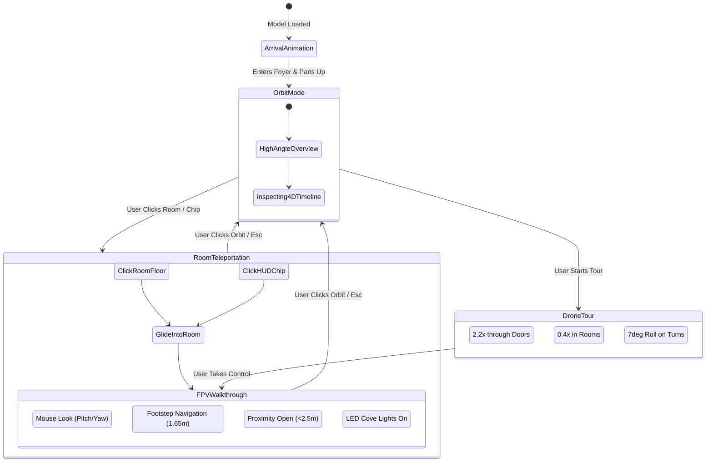

# Architectural Design Document: Enscape-Quality 3D/4D Visualization & FPV Walkthrough Engine

**Document Version:** 2.0 (Final Architecture Blueprint)  
**Target Module:** `frontend/src/features/plan-viewer/`  
**API Cost:** ₹0 (Fully client-side Three.js PBR procedural rendering)  
**Status:** Approved for Implementation

---

## 1. Executive Summary & Core Objective

The goal of this architectural overhaul is to transform the 3D floor plan viewer from a flat, toy-like diagram into an **Enscape-tier photorealistic architectural inspection and first-person walkthrough engine**.

### Primary Problems Addressed:
1. **Monolithic Pale Aesthetic**: The previous dollhouse render featured uniform white walls, identical flat surfaces, and a plain cream background that looked like a simplified clay blockout rather than a real home.
2. **Lack of Construction Realism**: Real walls feature recessed skirting/baseboards ($10\text{cm}$), header/lintel beams over doors and windows, distinct wall finishes (sand stucco exterior vs. warm eggshell plaster interior), and recessed window sills.
3. **Absence of First-Person Experience**: Users could only view the house from an external perspective. Architects, buyers, and builders need to step inside the house, inspect finishes at human eye level ($1.65\text{m}$), and visualize the flow of space.
4. **Static Openings & Roofless Feel**: In interior walkthrough mode, missing ceilings make rooms feel unfinished; doors remain static instead of swinging open as a visitor approaches.

### Core Visual Deliverables:
- **Procedural PBR Engine**: High-resolution Canvas-generated PBR textures with world-space UV mapping (Carrara polished marble, herringbone oak parquet, anti-skid ceramic tiles, textured stucco, brushed brass).
- **First-Person Arrival Flow**: Smooth cinematic animation welcoming the user by entering through the front door into the foyer upon initial import.
- **Click-to-Enter Virtual Review**: Clicking any room polygon or bottom HUD chip smoothly glides the camera inside that room at $1.65\text{m}$ eye level with free $360^\circ$ mouse look.
- **Auto-Culling Smart Ceilings with Cove Lighting**: Ceilings hide automatically in Orbit/Drone mode ($Y > 3.0\text{m}$) and materialize in Walkthrough mode ($Y \le 2.2\text{m}$) complete with glowing LED cove strips and recessed downlights.
- **Dynamic Proximity Door Auto-Swing**: Doors smoothly swing open when the visitor approaches within $2.5\text{m}$.
- **Higgsfield Cinematic Drone Tour & Waypoint Walkthrough**: Smooth spline camera navigation (`CatmullRomCurve3`) through doorways with speed ramping ($2.2\times$ through doors, $0.4\times$ in rooms) and banking roll ($\pm 7^\circ$).
- **4D Construction Buildup Timeline**: Interactive scrubber slider animating the building's physical assembly: Blueprint ➔ Plinth ➔ Framing ➔ Walls/Lintels ➔ Openings ➔ Finishes ➔ Furniture.

---

## 2. System Architecture & Component Mapping

```
frontend/src/features/plan-viewer/
├── materials/
│   └── materials.ts           # Procedural PBR Canvas Engine & Physical Glass Shaders
├── builders/
│   ├── buildWallsWithOpenings.tsx # Slicing, Lintel Beams, Skirting & Crown Mouldings
│   ├── buildOpenings.ts       # Proximity Auto-Swing Doors, Window Frames & Marble Sills
│   ├── buildFloors.ts         # Plinth Slab, Multi-Zone PBR Floors & Auto-Culling Ceilings
│   ├── buildRailings.tsx      # U-Turn Staircases, Handrails & Balcony Glass Railings
│   └── wallSynthesizer.ts     # Boundary verification & Room classification helpers
├── furniture/
│   ├── furnitureLibrary.tsx   # Detailed PBR Furniture Catalog (Beds, Sofas, Kitchen, Bath)
│   └── roomFurnisher.tsx      # Intelligent Auto-Staging with Anchor Wall Solver
├── controls/
│   ├── FpvWalkthroughControls.ts # First-Person WASD + Mouse Look Camera Rig
│   ├── SplineTourRig.ts       # Waypoint Generator & Speed-Ramped Drone Path
│   └── ProximitySensor.ts     # Real-time door proximity collision & swing trigger
├── PlanViewer.tsx             # Main Stage: Sun Simulator, 4D Scrubber, Mode Switcher & HUD
└── index.ts                   # Public exports & integration bridges
```

---

## 3. Detailed Component Specifications

### 3.1 `materials/materials.ts` — Procedural PBR Shader Engine
To achieve Enscape-tier realism at ₹0 API cost and zero heavy asset downloads, textures are procedurally synthesized onto high-resolution HTML5 Canvases:

1. **Italian Polished Carrara Marble** (Living, Dining, Puja):
   - Off-white luminous porcelain base (`#F7F6F2`).
   - Multi-octave Perlin-vein fractal curves (`rgba(130, 120, 110, 0.12)`) with micro-fractures and gold specular highlights.
   - PBR: Roughness `0.18`, Metalness `0.05`, Clearcoat `0.6`, ClearcoatRoughness `0.1`.
2. **Herringbone Oak Parquet** (Bedrooms, Lounge):
   - 45-degree angled chevron parquet planks with individual plank tone jitter ($\pm 6\%$).
   - Dark recessed joints (`1.5px`, alpha `0.3`) and fine horizontal wood grain striations.
   - PBR: Roughness `0.35`, Metalness `0.02`.
3. **Anti-Skid Matte Ceramic Tiles** (Kitchen, Bathrooms, Wash):
   - $60\text{cm} \times 60\text{cm}$ grid with $2.5\text{mm}$ light grey grout line (`#D5D8DC`).
   - Micro-stipple bump noise to simulate non-slip texture.
   - PBR: Roughness `0.55`, Metalness `0.0`.
4. **Exterior Sand Stucco Plaster** (Exterior Walls):
   - Warm sandstone grain (`#EDE8DE`) with fine surface bump normal map.
   - PBR: Roughness `0.92`, Metalness `0.0`.
5. **Interior Silk Eggshell Plaster** (Interior Walls):
   - Refined architectural off-white (`#F9F8F5`), high diffuse bounce.
   - PBR: Roughness `0.85`, Metalness `0.0`.
6. **Physical Architectural Glass**:
   - `THREE.MeshPhysicalMaterial` with `transmission: 0.92`, `ior: 1.52`, `roughness: 0.04`, `thickness: 0.02`, `specularColor: 0xffffff`.
7. **Architectural Metal Accents**:
   - Brushed brass (`#D4AF37`, roughness `0.25`, metalness `0.85`) for handles and fixtures.
   - Dark bronze powder-coated aluminium (`#242629`, roughness `0.45`, metalness `0.4`) for frames and mullions.

### 3.2 `builders/buildWallsWithOpenings.tsx` — Structural Slicing & Detail Mouldings
Instead of monolithic single boxes, walls are constructed with authentic architectural detailing:
- **Structural Slicing**: Walls are subdivided into 3 vertical zones:
  1. *Wall Piers*: Full-height solid sections between door/window rough openings.
  2. *Sill Walls*: Solid masonry from floor level ($0\text{m}$) up to window sill ($0.9\text{m}$).
  3. *Lintel Beams*: Continuous concrete header spans from top of openings ($2.1\text{m}$) to full wall height ($2.9\text{m}$).
- **Skirting / Baseboard**: A continuous $10\text{cm}$ high by $1.5\text{cm}$ relief baseboard along the foot of all interior walls in dark walnut or matching floor trim.
- **Ceiling Crown Moulding**: A $6\text{cm}$ decorative crown profile running along wall tops where they meet the ceiling.
- **Wall Cap Detailing**: Dark charcoal cap (`#2D2E32`, $8\text{cm}$ high) on exterior parapets for crisp architectural silhouette.

### 3.3 `builders/buildOpenings.ts` — Proximity Auto-Swing Doors & Windows
- **Timber Panel Doors**:
  - Engineered wood frame with $3.5\text{cm}$ stop moulding.
  - Recessed twin-panel door leaf with dark bronze or brushed brass lever handles.
  - **Proximity Sensor**: Each door node tracks distance to the camera. When camera distance $d < 2.5\text{m}$, the leaf rotates from $0^\circ$ (closed) to $75^\circ$ (open) via smooth exponential lerp ($k = 0.1$). When camera leaves $d > 3.0\text{m}$, it smoothly closes.
- **Glazed Window Units**:
  - Powder-coated multi-panel sliding and casement assemblies with vertical mullions spaced every $1.0\text{m}$.
  - Polished white marble window sill slab projecting $4\text{cm}$ into the room at the base of every window.

### 3.4 `builders/buildFloors.ts` — Plinth, Multi-Zone Floors & Auto-Culling Ceilings
- **Elevated Plinth Foundation**:
  - $0.45\text{m}$ raised ground slab (`#E2DDD5`) projecting $20\text{cm}$ around the house perimeter.
  - Front entrance staircase with 2 shallow cantilevered steps ($15\text{cm}$ riser, $30\text{cm}$ tread).
  - Outdoor lawn green grass plane surrounding the house plinth with subtle noise texture.
- **Multi-Zone Interior Flooring**:
  - Extruded room polygons (`y = 0.002\text{m}`) mapped to room-specific PBR materials.
  - Void punching for open ventilation shafts and vertical courtyards.
- **Auto-Culling Smart Ceilings with LED Cove Lighting**:
  - Ceiling slab extruded over all interior rooms at $Y = 2.85\text{m}$.
  - In Orbit/Drone mode ($Y > 3.0\text{m}$): Ceilings automatically transition opacity to $0$ and set `visible = false` so the dollhouse remains fully visible from above.
  - In Walkthrough mode ($Y \le 2.2\text{m}$): Ceilings become solid white plaster, with recessed cove LED perimeter troughs glowing with warm golden ambient light ($3000\text{K}$) and downlights over focal furniture pieces.

### 3.5 `builders/buildRailings.tsx` — Stairs & Balconies
- **Dog-Leg / U-Turn Staircase Assembly**:
  - Concrete stringers, polished wood tread toppers, and white risers.
  - Intermediate landing slab connecting lower and upper flights.
  - Continuous tempered glass balustrade with brushed stainless steel top rail.
- **Balcony & Terrace Glass Railings**:
  - $1.05\text{m}$ high safety glass panels clamped in dark spigots along balcony edges.

### 3.6 `furniture/furnitureLibrary.tsx` & `roomFurnisher.tsx` — Intelligent Auto-Staging
- Spatial solver reads room polygon and openings:
  - Determines the **longest solid anchor wall** with zero door conflicts.
  - Places scaled, high-detail PBR furniture:
    - *Master Bedroom*: King bed with padded headboard, layered duvet, 4 pillows, bedside tables with working table lamps, wardrobe on opposite wall.
    - *Living Room*: L-sectional linen sofa, brass-accent coffee table with decorative book/tray, media credenza with ultra-thin OLED TV, textured area rug, and tall potted fiddle leaf fig plant.
    - *Dining*: Modern walnut dining table with 6 upholstered chairs and hanging chandelier.
    - *Kitchen*: Quartz waterfall island with under-counter LED strip and 3 modern bar stools; L-shaped cabinetry with induction cooktop and sink.
    - *Bathrooms*: Floating vanity with illuminated LED mirror, wall-mounted WC, glass-enclosed shower stall with rain shower head.

---

## 4. Camera Systems & Interactive Walkthrough Navigation

The viewer provides three distinct, seamlessly connected viewing experiences:



### 4.1 Welcome Arrival Flow
Upon initial plan import:
1. Camera starts outside at the front entrance gate ($X=0, Y=1.8, Z=14$).
2. Glides smoothly through the main doorway into the central foyer ($2.5\text{s}$ ease-in-out).
3. The front door swings open as the camera approaches.
4. Camera pans gently to showcase the living room finishes, then smoothly pulls up into the signature isometric overview, ready for interaction.

### 4.2 Click-to-Enter Room Teleportation & Bottom HUD Bar
- **Direct 3D Click**: Clicking any room floor surface in the 3D scene smoothly transitions the camera from high-altitude down to human eye level ($Y = 1.65\text{m}$) at that exact position, enabling first-person free-look mode.
- **Bottom HUD Room Chips**: A horizontal scrolling pill bar at the bottom displaying all rooms (`Living Room`, `Kitchen`, `Master Bedroom`, `Balcony`, `Dining`, etc.). Clicking any pill smoothly glides the camera inside that specific room.
- **"Exit to Orbit" Pill**: A persistent top-right button allows instant return to the aerial dollhouse overview at any moment.

### 4.3 4D Construction Buildup Timeline
An interactive scrubber slider at the bottom of the screen with Play/Pause controls:
- **Phase 0 (0% - 15%)**: Site Grid & Plinth Slab Pouring with entrance steps.
- **Phase 1 (15% - 35%)**: RCC Columns, Shear Walls & Structural Lintel Beams.
- **Phase 2 (35% - 60%)**: Masonry Walls, Skirting & Window Sill Placements.
- **Phase 3 (60% - 80%)**: Glazed Doors, Windows & Flooring Finishes.
- **Phase 4 (80% - 100%)**: Final Ceiling Cove Lighting, Auto-Staged Furniture & Greenery.

---

## 5. Implementation Plan & Milestones

| Milestone | Deliverables | Verification Criteria |
|---|---|---|
| **Phase 1: Materials & PBR Shaders** | Procedural Canvas PBR textures (Carrara marble, Herringbone oak, ceramic tile, stucco plaster, physical glass, brass). | Textures tile seamlessly without stretch; glass shows realistic transmission and specular reflections. |
| **Phase 2: Architectural Geometry Slicing** | Sliced walls with window sills and lintel beams; $10\text{cm}$ skirting boards and ceiling crown mouldings; elevated plinth foundation. | Walls show structural depth; baseboard lines wall perimeters; plinth steps visible at entrance. |
| **Phase 3: Smart Ceilings & Proximity Openings** | Smart ceilings that auto-cull above $3.0\text{m}$ and appear with LED cove lights below $2.2\text{m}$; proximity auto-swing doors. | Approaching a door opens it; dropping camera into room shows illuminated ceiling. |
| **Phase 4: High-Detail Furniture Catalog** | Modular PBR furniture (King bed, L-sofa, dining set, modern kitchen island, luxury bathroom vanity, lighting lamps). | Rooms are believably staged without colliding with doors or walls. |
| **Phase 5: FPV Rig, Teleportation & Room HUD** | Welcome arrival animation; click-to-enter room teleportation; bottom room chips; WASD + free look FPV camera. | Clicking "Master Bedroom" smoothly glides camera inside at $1.65\text{m}$; user can look around $360^\circ$. |
| **Phase 6: 4D Buildup Timeline & Polish** | Interactive 4D construction scrubber; daytime sun simulator with golden hour option; production build and tests. | Scrubber animates phases from slab to finished home; `npm run build` and all vitest suites pass 100%. |

---

## 6. Verification Plan

1. **Automated Unit & Integration Testing**:
   - `npx vitest run --config vite.config.ts`: Verify all 47 existing tests + new PBR texture and proximity calculation tests pass.
   - `npm run build`: Verify TypeScript compilation and Vite bundling finish cleanly with zero errors.
2. **Interactive Manual Acceptance Testing**:
   - Load Shalimar Greens / AI-generated 2-BHK plan.
   - Confirm welcome animation plays on import.
   - Click room chips (Living, Kitchen, Bedroom) and verify smooth FPV entry and $360^\circ$ look-around.
   - Test door auto-swinging as camera moves through doors.
   - Test 4D construction timeline slider forward and backward.
   - Verify material highlighting from the BOQ sheet continues to work seamlessly.

