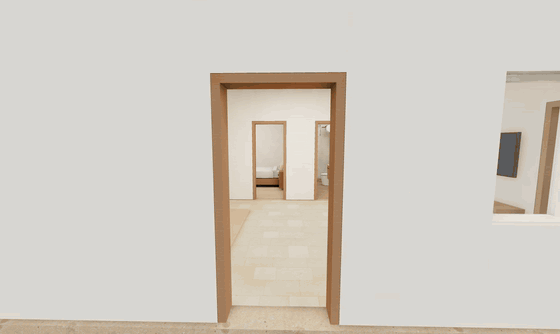
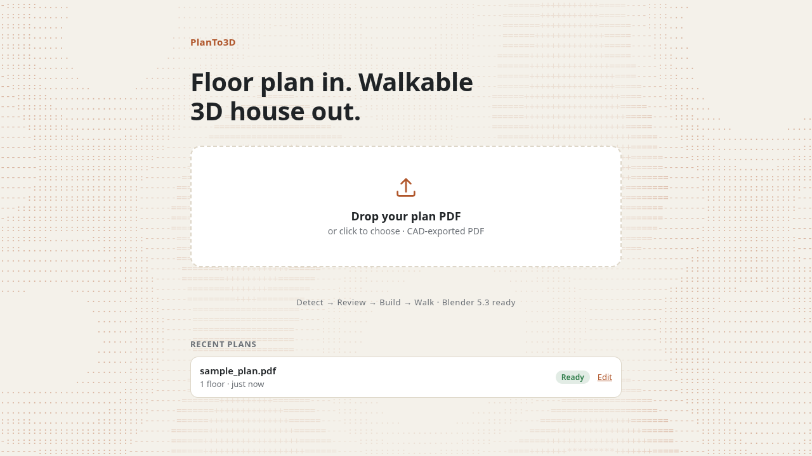
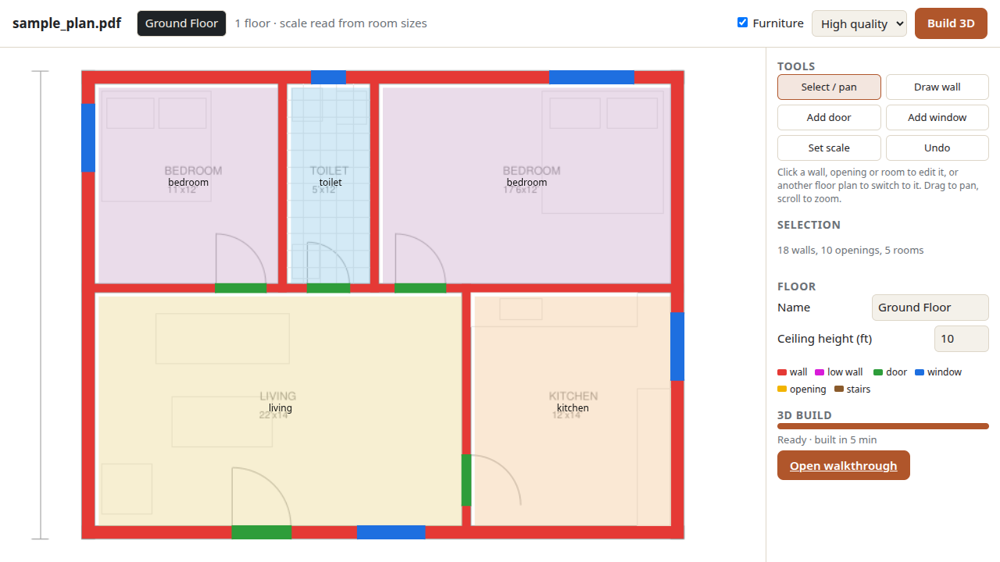
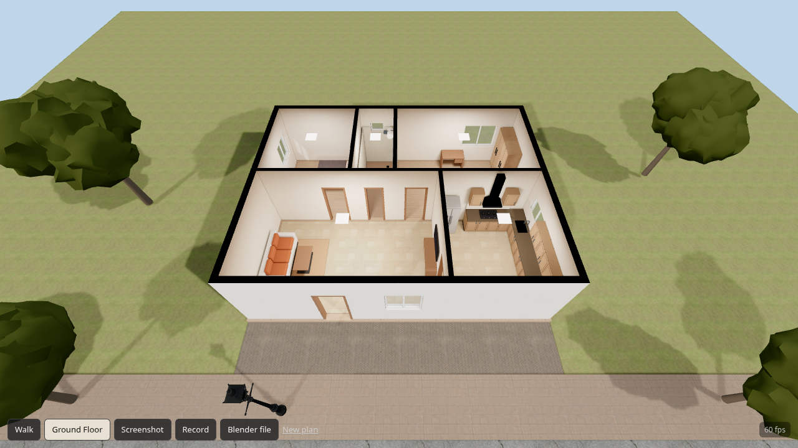
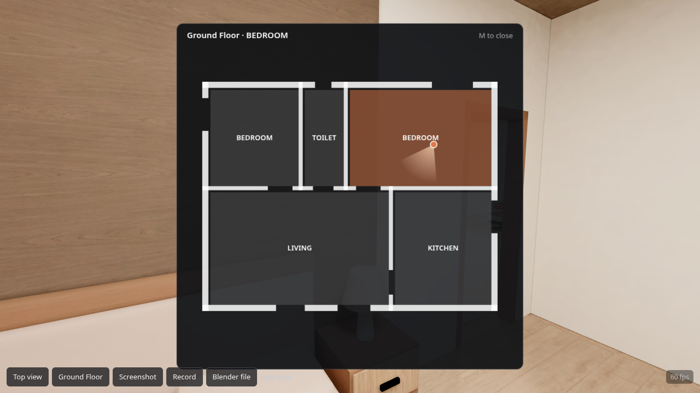
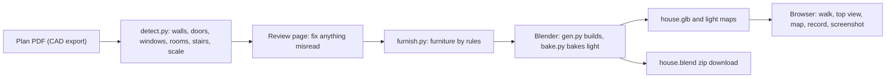
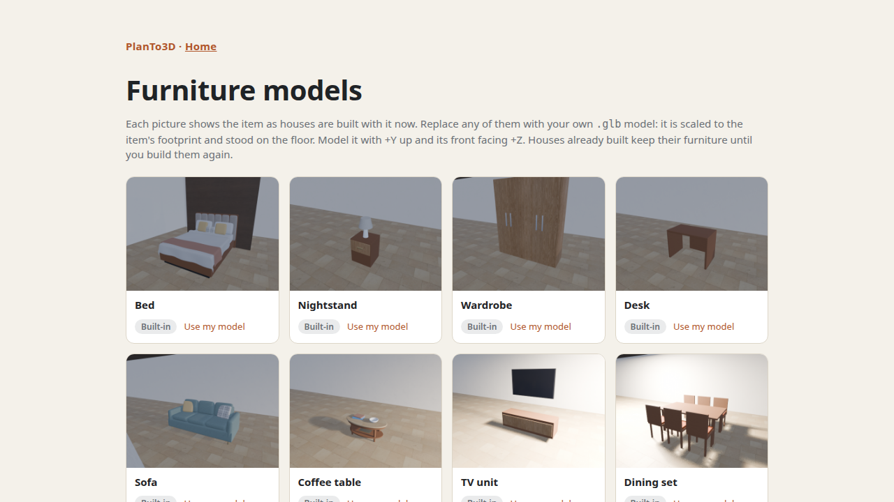
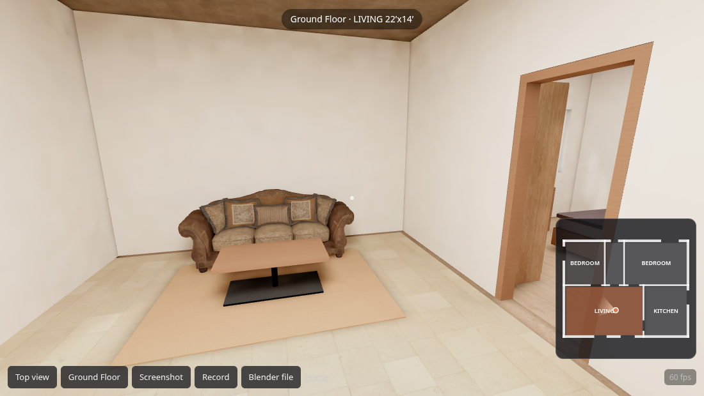
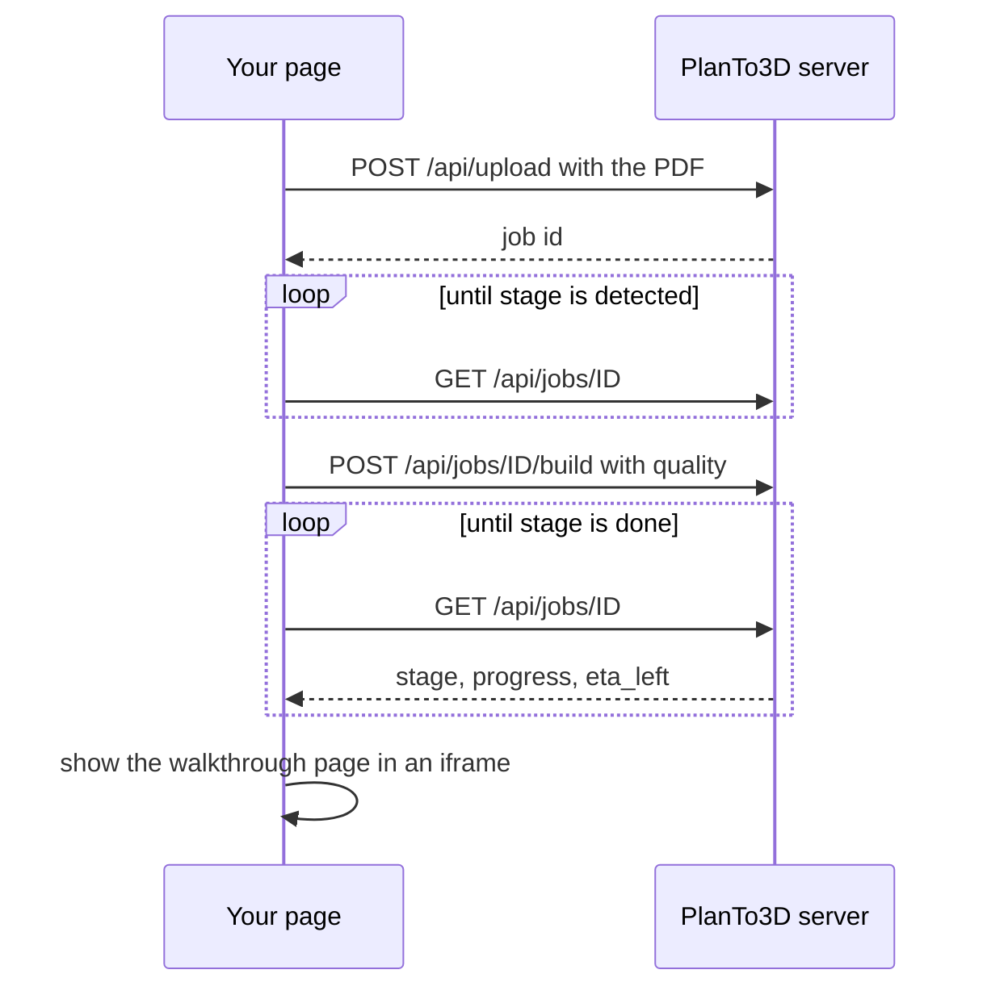

# PlanTo3D

**Floor plan PDF in. Furnished, walkable 3D house out.** No AI model and no LLM: every step is geometry, rules and Blender.

<a href="docs/demo.mp4"></a>

<sub>Shown at 2× speed. <a href="docs/demo.mp4">Watch the full video (MP4, 28 s)</a>, recorded with the walkthrough's own Record button.</sub>

| Upload | Review the detected plan |
|---|---|
|  |  |
| **Top view** | **Map (press M)** |
|  |  |

All screenshots show [`examples/sample_plan.pdf`](examples/sample_plan.pdf), a made-up drawing that ships with the repository.

## How it works



| Step | File | Method |
|---|---|---|
| Read the PDF | `vector.py` | `pdftocairo -svg` for every line, curve and fill; `pdftotext -bbox` for words and positions |
| Walls | `detect.py` | Pairs of parallel lines in the heaviest grey pen. Evenly spaced families (tiles, stair treads, glass) are rejected. Filled squares touching a wall are columns |
| Scale | `detect.py` | Distance between the walls around a room label against the size written in it (`14'x12'8"`); the most common value wins |
| Openings | `detect.py` | Glass lines inside a wall band make a window. A gap with a swing arc is a door; a bare gap up to 4.6 ft is a door only if a line is drawn across it |
| Rooms | `detect.py` | Flood fill between walls and openings, split along single drawn lines, named from the labels (BED, TOI, KIT, DRG…) |
| Stairs, storeys | `detect.py` | Runs of evenly spaced treads next to UP / DN; separate wall clusters on a sheet are separate storeys, ordered by their titles |
| Furniture | `furnish.py` | Rules per room type: bed on the longest free wall, WC and basin by the door, L-shaped kitchen with the sink under the window, sofa facing a TV wall. Items keep clear of doors, windows and each other |
| 3D | `blender/gen.py` | Walls with openings cut, sills and lintels, frames and glass, floors per room type, stairs, roof with parapet, site with road and trees |
| Lighting | `blender/bake.py` | Cycles bakes direct and bounced light into one light map per storey. The browser multiplies textures by it: no real-time lights, so it runs on any GPU |
| Viewer | `web/view.js` | three.js, unlit materials, wall collision, stairs between storeys |

## Quick start

Needs Python 3 (developed on 3.14), Node 18+ (22+ for the browser test), [Blender](https://www.blender.org/download/) 4.2+ and poppler (`apt install poppler-utils` or `brew install poppler`).

```bash
git clone <this repo> && cd planto3d
./run.sh                         # installs three.js, serves http://127.0.0.1:8080
```

Open the page. It checks Blender, the PDF tools, the viewer library and the materials, and accepts a plan only when all four are in place. The textures and models (about 75 MB, CC0, from [Poly Haven](https://polyhaven.com)) are not in the repository: press **Download materials** on the page, or run `python3 fetch_assets.py`.

Then press **Try the sample plan**, or drop your own PDF on the page.

### macOS

```bash
brew install python node poppler
brew install --cask blender
export BLENDER=/Applications/Blender.app/Contents/MacOS/Blender     # Blender is not on PATH on a Mac
./run.sh
```

### Windows

Install [Python](https://www.python.org/downloads/), [Node.js](https://nodejs.org), [Blender](https://www.blender.org/download/) and poppler (`winget install oschwartz10612.Poppler`, or `choco install poppler`), then in PowerShell:

```powershell
npm install
$env:BLENDER = "C:\Program Files\Blender Foundation\Blender 4.5\blender.exe"    # your Blender version's folder
python server.py
```

`pdftocairo` must be found on `PATH`; the home page tells you if it, or Blender, is missing. The project was developed and tested on Linux; the macOS and Windows steps have not been run.

```bash
./run.sh --port 9000 --host 0.0.0.0     # reachable from other devices
./run.sh --cors https://your-site.com   # let another site call the API
```

## What you get

| | |
|---|---|
| **Review before building** | Detected walls, doors, windows and rooms drawn over your PDF. Click to change or delete, draw walls, add doors and windows, set the scale |
| **Furniture on or off** | Untick **Furniture** for empty rooms |
| **Time estimate** | The build box shows about how long is left, learned from earlier builds on the same machine |
| **Walkthrough** | W A S D and mouse on desktop, two thumbs on a phone. Starts at the entrance side of the plan |
| **Top view** (T) | The house from above, one storey at a time |
| **Map** (M) | Room names, stairs, where you stand and look |
| **Screenshot** (P) | PNG of about 4K size |
| **Record** (R) | Video of your walk as MP4 (browsers that record WebM are converted on the server; needs ffmpeg) |
| **Your own furniture** | The Furniture models page shows each item and lets you replace it with your `.glb` model |
| **Sample plan, delete** | "Try the sample plan" on the home page; every plan in the list has Delete |
| **Blender file** | The house as one `.blend` with every texture packed inside, in a zip |
| **Furniture models in the review page** | **Change furniture models** opens the furniture page in a window, so you can swap a model and then build |

### Your own furniture

| Furniture models page | A replaced sofa in a built house |
|---|---|
|  |  |

**Which renderer does what.** The walkthrough runs in the browser with three.js. Its light and shadows are computed once by Blender's Cycles engine and baked into light maps, so walking is smooth on any GPU but reflections and glossy highlights are not shown.

## Build time and accuracy

Measured on a laptop with an RTX 3050 (4 GB).

| One-storey house | Draft | High quality |
|---|---|---|
| Build + light bake | about 1.5 min | about 5 min |
| Light map of the storey | 2048 px | 4096 px |

Detector scores on two real CAD drawings that were measured by hand (the drawings are private and not included):

| Plan | Walls: precision / recall | Doors found | Windows found | Room types right |
|---|---|---|---|---|
| Two-storey house, ground floor | 0.88 / 0.97 | 100% | 100% | 100% |
| Two-storey house, first floor | 0.92 / 0.99 | 100% | 100% | 100% |
| Single floor of flats | 0.94 / 0.97 | 93% | 100% | 100% |

The sample drawing is read exactly: 18 walls, 5 doors, 5 windows, 5 rooms.

## Put it on your own site

The walkthrough is a page you can place in an `<iframe>`, and every step is an HTTP call.



```html
<iframe src="https://your-planto3d-host/web/view.html?job=JOB_ID&embed"
        style="width:100%;aspect-ratio:16/9;border:0" allow="fullscreen"></iframe>
```

[`examples/embed.html`](examples/embed.html) is a complete working page: upload, build, show.

| Call | Does |
|---|---|
| `GET /api/system` | What is installed: `{ ready, blender, pdf_tools, viewer, materials }` |
| `POST /api/upload` | Body: the PDF. Header `X-Filename`. Returns `{ id }` and starts detection. With `X-Detect: 0` it only draws the page images (any PDF, scans too) and the job waits at `uploaded` for an import |
| `POST /api/jobs/{id}/import` | Body `{ "plan": <plan JSON> \| null, "reader": "ai" \| "stored" \| "trace" \| "manual", "notice": "<300 characters at most>" }`: a plan read by another program, or (`plan: null`) an empty plan to trace over the page. Checked strictly; 400 with the reason, 409 while the job is read or built |
| `GET /api/jobs/{id}` | `{ stage, progress, message, floors, eta_left, reader, notice, pages }` (`reader`: `detector` or the import's). Stages: `detecting`, `detected`, `queued`, `building`, `done`, `failed` |
| `GET /jobs/{id}/plan.json` | The detected plan (feet): walls, openings, rooms, stairs per storey |
| `POST /api/jobs/{id}/plan` | Save an edited plan. `"furnish": false` builds empty rooms |
| `POST /api/jobs/{id}/build` | Body `{ "quality": "draft" \| "high" }`. Builds run one at a time |
| `POST /api/jobs/{id}/export` | Packs the Blender file. Returns `{ url }` of the zip |
| `GET /web/view.html?job={id}` | The walkthrough. `&embed` hides the link back to the upload page |
| `GET /web/edit.html?job={id}` | The review page |
| `GET /api/jobs` | The 30 most recent plans |
| `DELETE /api/jobs/{id}` | Delete a plan and its house |
| `GET /api/furniture` | Replaceable items; `POST /api/furniture/{name}` (a `.glb`) replaces one, `DELETE` restores it |

To let people correct the plan first, show `/web/edit.html?job={id}` in the iframe instead of building straight away.

## Project layout

```
server.py          web server and build queue (standard library only)
detect.py          plan PDF -> plan JSON
vector.py          PDF lines, curves, fills and words (poppler)
furnish.py         furniture rules (pure Python)
catalog.py         furniture that can be replaced by your own models
fetch_assets.py    downloads the CC0 textures, models and sky
blender/           gen.py (build), bake.py (light maps), lib.py (parts), cinema.py (video renderer)
web/               home, review and walkthrough pages
examples/          sample_plan.pdf, its generator, embed.html
tests/             detector, furniture, walking and browser tests
tools/             video and debugging helpers
AGENTS.md          guide for AI coding agents working on this project
jobs/              one folder per uploaded plan (not in git)
assets/            downloaded materials (not in git)
```

## Tests

```bash
tests/run_all.sh                                   # detector on the sample, furniture clashes, stair and wall walking
CHROME=/path/to/chromium node tests/test_site.mjs examples/sample_plan.pdf http://127.0.0.1:8080
```

`test_site.mjs` drives a real headless browser against a running server (about 2 min, one draft build): upload page, Furniture box, build box, screenshot, recording, map and top view. `tests/test_detect.py` scores the detector on the private drawings and is skipped unless `PLANTO3D_FIXTURES` points at them.

## Extras

- `blender/cinema.py` renders a dusk video tour of a built house along a camera path, pausing when the GPU or CPU gets hot. `python3 fetch_assets.py --tour` fetches its sky.
- `tools/tour.py`, `tools/record.mjs`, `tools/titles.py`, `tools/retime.py`, `tools/fill_frames.py`: plan a walking route, record it from the viewer, add room titles, change speed, fill skipped frames.
- `tools/dbg_plan.py` draws a plan JSON over its PDF page.

## Limits

- **Vector PDFs only.** Scans, photos and images are refused.
- **Axis-aligned walls.** Slanted and curved walls are not detected; draw them on the review page.
- **Labels in English**, sizes in feet and inches. Without size labels the scale is a guess and must be set on the review page.
- **Wall groups.** If the drawing's walls fall into groups whose outlines do not overlap, the detector reads them as separate plans and can drop a part of the house.
- **No login.** Anyone who can reach the server can upload, build and read every plan. Keep it on a trusted network or behind your own backend. `--cors *` lets any website call it from the visitor's browser: name your origin instead.
- **Disk.** Plans stay until you delete them; a built house takes about 10 to 70 MB in `jobs/`.

## Credits

- [three.js](https://threejs.org) (MIT) for the viewer.
- [Blender](https://www.blender.org) for building and baking.
- [Poly Haven](https://polyhaven.com) for the CC0 textures, models and skies.
